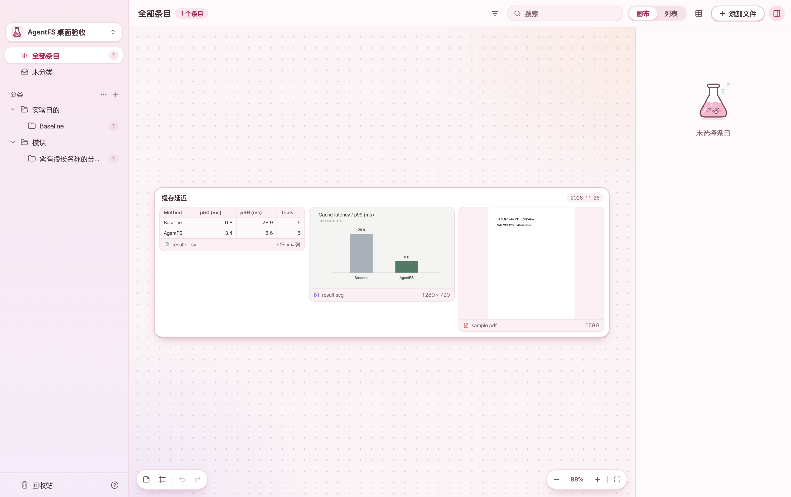
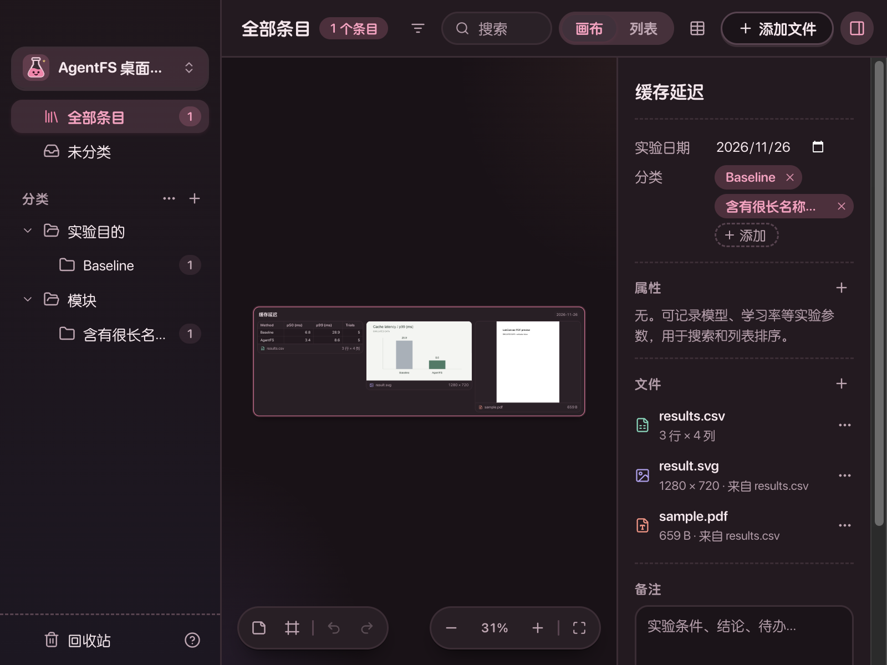
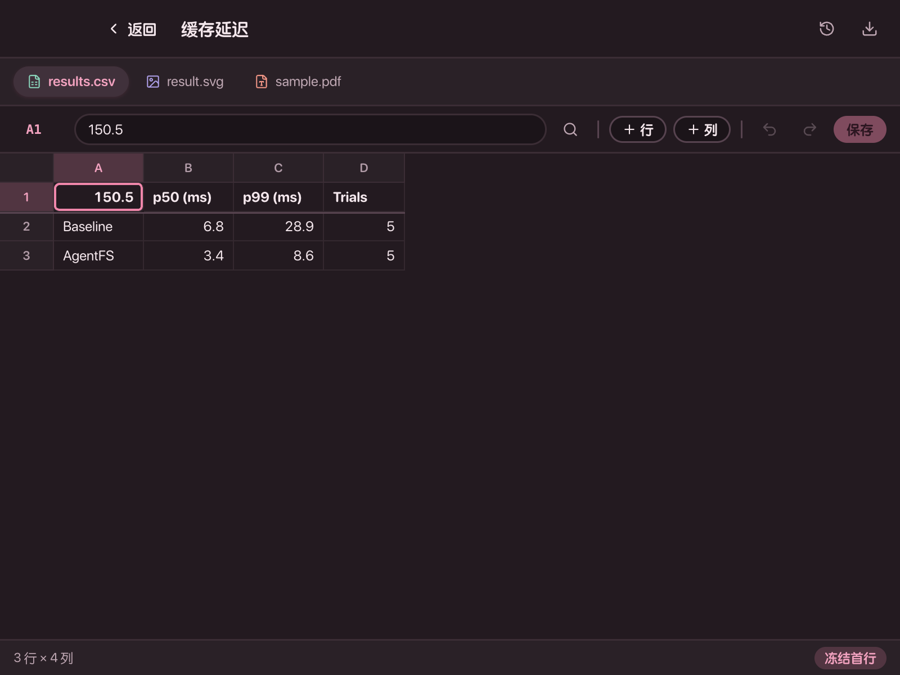

<div align="center">


# LabCanvas

**Local-First, Agent-Native Research Data Canvas & Versioned Workspace**

Organize experiment tables, figures, PDFs, logs, and structured metadata in one local library—combining an infinite spatial canvas, a sortable table view, built-in viewers, and an idempotent CLI backed by shared SQLite and content-addressed storage.

[简体中文](README.md) · [English](README.en.md)

[](https://nodejs.org/)
[](https://www.electronjs.org/)
[](https://react.dev/)
[](https://www.sqlite.org/)
[](#architecture--design-principles)

<br />

<picture>
  <source media="(prefers-color-scheme: dark)" srcset="docs/preview-canvas-dark.png" />
  <source media="(prefers-color-scheme: light)" srcset="docs/preview-canvas-light.png" />
  
</picture>

</div>

---

## Why LabCanvas

Research and engineering experiments naturally scatter across formats: CSV/XLSX tables pulled from remote clusters, SVG/PNG/PDF plots generated by analysis scripts, raw run logs, hyperparameters, and ad-hoc notes. Conventional folder trees enforce a single hierarchy—duplicating files breaks provenance—while cloud note apps struggle with large local artifacts and rarely offer idempotent ingestion interfaces for automation scripts or AI agents.

LabCanvas provides a focused, local-first foundation built around how experiments actually evolve:

- **Entries as Experiment Units**: Group a result table and its derived plots into a single entry with side-by-side live previews, shared experiment dates, key-value fields, and notes—merge or split anytime.
- **Reference-Based Collections**: File the same entry simultaneously under `Date/2026-11-10`, `Module/Cache`, and `Goal/Baseline` without duplicating bytes. Deleting a collection or removing a reference never destroys underlying files.
- **Spatial Canvas & Structured List**: Arrange cards freely on an infinite canvas with sticky notes and grouping frames, or switch to a sortable list view with custom property columns. Each collection persists its own layout and viewport.
- **Provenance Tracking & File Versioning**: Built-in viewers and editors for tables, text, images, and PDFs. Saving edits automatically appends immutable versions with one-click restore, and flags derived figures as stale whenever their source table advances.
- **Agent-Native CLI & Live Sync**: Run dry-run validation (`--dry-run`), idempotent updates (`-k/--key`), manifest batch imports, and full-text queries from any terminal or AI agent. Open desktop windows automatically reflect CLI writes in real time.
- **100% Local & Offline**: Powered by native `node:sqlite` and a SHA-256 content-addressed object store, bound strictly to `127.0.0.1`. Zero accounts, zero telemetry, zero cloud lock-in, with single-command hot backups and integrity checks.

---

## Visual Tour

<table>
  <tr>
    <td width="50%">
      
      <p align="center"><sub><b>Spatial Canvas (Light Mode)</b> — Live content thumbnails, multi-file cards, and per-view layouts</sub></p>
    </td>
    <td width="50%">
      
      <p align="center"><sub><b>Adaptive Compact Layout (Dark Mode)</b> — Follows system appearance and fits narrow split-screen windows</sub></p>
    </td>
  </tr>
  <tr>
    <td colspan="2">
      
      <p align="center"><sub><b>Built-In Table Viewer & Editor</b> — Multi-sheet CSV/TSV/XLSX editing, formula bar, frozen header row, TSV paste, and version diffing</sub></p>
    </td>
  </tr>
</table>

---

## Key Capabilities

| Area | Capabilities |
| :--- | :--- |
| **Spatial Canvas & Annotations** | Infinite pan & zoom, draggable/resizable cards, auto-tidy packing, Shift-marquee multi-select, undo/redo, sticky notes, and grouping frames—persisted independently per collection |
| **List View & Structured Filters** | Sortable table with built-in columns (files, date, collections, size, timestamps) and dynamic custom property columns (e.g., `lr`, `model`, `seed`), plus global file-kind filtering |
| **Full-Text Search (FTS5)** | Instant SQLite FTS5 indexing across titles, notes, custom fields, collection names, filenames, and extracted CSV/text contents with contextual match snippets |
| **Built-In Viewers & Diff Compare** | Native viewers for tables (`CSV`/`TSV`/`XLSX`), images (`PNG`/`JPG`/`WebP`/`GIF`/`SVG`/`AVIF`/`TIFF`), PDFs (`pdf.js`), and 25+ text/code formats, with **side-by-side comparison** (synced scroll, linked zoom, diff highlighting) |
| **Spreadsheet Editing & Pagination** | Virtualized grid with formula bar, multi-sheet switching, row/column insertion & deletion, TSV paste, and frozen headers; sheets exceeding 20,000 rows switch cleanly to paginated browsing |
| **Content-Addressed Versioning** | Files are deduplicated by SHA-256 in an immutable object store; saving edits or re-importing with the same `--key` records incremental versions that can be inspected or restored at any time |
| **Stale Figure Detection** | Figures and PDFs inside an entry with a single table automatically link to that table (or can be linked explicitly); updating the source table surfaces a stale indicator on dependent figures |
| **Safe Deletion & Portability** | Soft-delete trash preserving collection links and canvas positions, one-click restore, reference-counted garbage collection, ZIP archive export, and consistent SQLite hot backups |

---

## Quick Start

### Prerequisites

- **Node.js** `>= 22.13.0` (uses built-in `node:sqlite`; Node.js 24 LTS recommended)
- **Platform**: macOS and Windows (both have packaged desktop installers); Web mode and CLI run on macOS, Linux, and Windows

### Install & Run from Source

```bash
# 1. Clone the repository and install dependencies
git clone https://github.com/Livia-Tassel/LabCanvas.git
cd LabCanvas
npm ci

# 2. Build frontend assets and PDF worker files
npm run build

# 3. Launch the Electron desktop application
npm run desktop
```

Additional launch options:

| Mode | Command | Description |
| :--- | :--- | :--- |
| **macOS Launcher** | Double-click `launch-labcanvas.command` | Checks environment and launches the desktop window |
| **Local Web App** | `npm start` | Starts the loopback server at `http://127.0.0.1:4317` |
| **Development Mode** | `npm run dev` | Starts Vite HMR dev server alongside the local API server |
| **Seed Demo Data** | `npm run demo` | Populates a simulated AgentFS project in the active library |
| **Package for macOS** | `npm run package:mac` | Builds an Apple Silicon disk image at `release/LabCanvas-1.0.0-arm64.dmg` |
| **Package for Windows** | `npm run package:win` | Builds an x64 installer at `release/LabCanvas-1.0.0-x64-setup.exe` (requires wine when cross-packaging from macOS/Linux) |

Windows users can also grab `LabCanvas-1.0.0-x64-setup.exe` directly from [GitHub Releases](https://github.com/Livia-Tassel/LabCanvas/releases); the installer bundles the Node runtime, so no prerequisites are needed.

> [!NOTE]
> By default, LabCanvas stores its library in `~/.labcanvas`. Set `LABCANVAS_HOME=/path/to/dir` to point the desktop app, web server, and CLI at any custom library directory.

---

## CLI & AI Agent Workflows

LabCanvas ships with a first-class CLI designed for experiment pipelines and coding agents (Claude Code, Codex, Gemini CLI, etc.). The CLI operates directly on the local SQLite database and object store—**working seamlessly even when the GUI is closed**—while open desktop windows auto-refresh whenever the CLI commits changes.

Run `./labcanvas` inside the repository or execute `npm link` once to install `labcanvas` globally:

```bash
# Create a project (JSON output is automatic when stdout is not a TTY)
labcanvas project create AgentFS --slug agentfs --json

# Ingest a table + figure together with metadata, fields, and an idempotent key
labcanvas add results.csv plot.svg -p agentfs \
  -c "Goal/Baseline" \
  -c "Module/Cache" \
  -d 2026-11-20 \
  -t "Cache Latency Ablation" \
  -f lr=3e-4 -f batch=64 \
  -k cache-ablation-001 --json

# Dry-run and atomically commit a declarative manifest (all-or-nothing rollback on error)
labcanvas import ./examples/manifest.json -p agentfs --dry-run --json
labcanvas import ./examples/manifest.json -p agentfs --json

# Full-text search across metadata and file contents
labcanvas search "Baseline" -p agentfs --json

# Create a consistent hot backup and verify library integrity
labcanvas backup ~/labcanvas-backup --json
labcanvas doctor --json
```

<details>
<summary><b>Example declarative import manifest (<code>examples/manifest.json</code>)</b></summary>

```json
{
  "$schema": "../docs/import.schema.json",
  "entries": [
    {
      "key": "example-cache-001",
      "title": "缓存延迟对比 · 模拟数据",
      "date": "2026-11-10",
      "note": "实验命令：python benchmark.py --config config.json",
      "collections": ["模块测试/缓存", "实验日期/2026-11-10", "实验目的/Baseline"],
      "files": [
        "results.csv",
        { "path": "result.svg", "source": "results.csv" }
      ]
    }
  ]
}
```

</details>

See **[Agent Interface Reference](docs/AGENT_API.md)** and **[Import JSON Schema](docs/import.schema.json)** for full CLI flags, structured error codes, and local HTTP API routes.

---

## Architecture & Design Principles

```text
┌───────────────────────────┐      ┌──────────────────────────────┐
│   Electron Desktop / Web  │      │     CLI / Scripts / Agents   │
│  React 19 + TS + Canvas   │      │    labcanvas add / import    │
└─────────────┬─────────────┘      └──────────────┬───────────────┘
              │ HTTP + SSE (127.0.0.1 only)       │ Direct SQLite Access
              ▼                                   ▼
┌─────────────────────────────────────────────────────────────────┐
│                    Local Store Engine (Node.js)                 │
│   Express 5 API  ·  ExcelJS / csv-parse  ·  Sharp  ·  ZIP       │
└─────────────┬───────────────────────────────────┬───────────────┘
              ▼                                   ▼
┌───────────────────────────┐      ┌──────────────────────────────┐
│      SQLite + FTS5        │      │   Content-Addressed Store    │
│  ~/.labcanvas/lab.sqlite  │      │  ~/.labcanvas/objects/<sha>  │
│  Meta · Trees · Layouts   │      │  Immutable Blobs & Thumbs    │
└───────────────────────────┘      └──────────────────────────────┘
```

### Core Storage Invariants

1. **Managed Imports**: Imported files are copied into the content-addressed object store so moving or deleting source directories never breaks library links.
2. **Reference-Only Collections**: Placing an entry into multiple collections creates lightweight membership rows without duplicating bytes or overwriting per-view canvas layouts.
3. **Immutable History**: Editing tables/text or re-importing under the same `--key` appends a new version rather than mutating past bytes, preventing accidental data loss.
4. **Strict Local Boundary**: The HTTP server enforces loopback `Host` and same-origin `Origin` checks plus strict CSP headers. Built-in guardrails: 200 MB max per file, 2 MB max for in-app text editing, 3.9 GB max per ZIP export.

---

## Project Structure

```text
LabCanvas/
├── src/                  # React 19 + TypeScript frontend
│   ├── components/       # Spatial canvas, list view, sidebar, inspector, dialogs, visual art
│   └── viewer/           # Built-in table, image, PDF, text viewers & side-by-side comparison
├── server/               # Local API server & storage engine (SQLite, CAS, parsers, ZIP export)
├── cli/                  # Agent-friendly CLI entrypoint (labcanvas)
├── desktop/              # Electron main process, preload script, and macOS icon assets
├── docs/                 # Agent API reference, JSON Schema, product spec, and validation log
├── examples/             # Runnable sample artifacts and manifest.json
├── scripts/              # Dev runner, PDF asset copy, macOS packaging, and desktop verifier
└── tests/                # Unit tests and Playwright end-to-end workflow specs
```

---

## Verification & Testing

LabCanvas includes core storage/API/CLI unit tests, Playwright end-to-end browser workflows, and Electron desktop verification:

```bash
npm run check                        # TypeScript check + production build + core unit tests
npm run test:e2e                     # Playwright E2E workflows (run `npx playwright install chromium` once)
npm run test:desktop -- --source     # Electron desktop window, light/dark theme, and server-reuse checks
```

See [Validation Record](docs/VALIDATION.md) for the test matrix and verification notes.

---

## Documentation

- [Agent CLI & Local HTTP API Reference](docs/AGENT_API.md)
- [Import Manifest JSON Schema](docs/import.schema.json)
- [Product Specification & Data Invariants](docs/PRODUCT.md)
- [Validation & Test Record](docs/VALIDATION.md)
