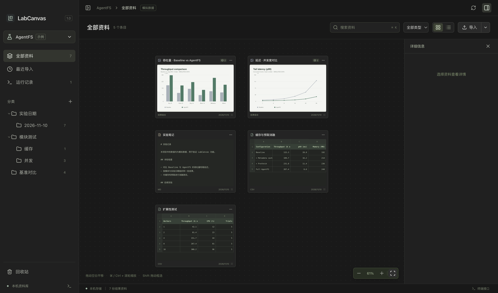

# LabCanvas 1.0

本机科研实验资料工作台。按项目隔离，按分类引用同一份资料，使用画布整理表格、图片和结果组合。GUI、CLI 与 HTTP API 共用持久化资料库。



## 打开应用

支持 macOS Apple Silicon 桌面版。先按下方说明安装依赖并构建界面，再运行 `npm run desktop`，或双击根目录的 `launch-labcanvas.command`。

需要可安装的应用时，运行 `npm run package:mac`，然后打开生成的 `release/LabCanvas-1.0.0-arm64.dmg`。构建产物不随源码仓库提交。

应用自带运行时，打开 `.app` 不需要运行 npm。首次启动自动建立 AgentFS 示例项目，所有示例数值均为模拟数据。可以从左上角项目菜单新建自己的项目。无需账户或联网。

默认数据存储在 `~/.labcanvas`，与源代码目录分开。导入的原文件会复制进资料库，删除或移动源文件不影响已导入资料。回收站和所有历史版本保留原始文件。

## 从源码运行

要求 Node.js 22.13 或以上版本，建议 Node.js 24 或以上版本。macOS 桌面打包默认面向 Apple Silicon；网页界面可在其他支持 Node 的系统上运行。

```sh
git clone https://github.com/Livia-Tassel/LabCanvas.git
cd LabCanvas
npm ci
npm run build
npm start
```

访问 `http://127.0.0.1:4317`。`npm run desktop` 打开桌面窗口；`npm run dev` 同时启动开发服务和 Vite（`http://127.0.0.1:5173`）。只运行一个占用 4317 的服务。桌面端会复用同一资料库对应的本机服务，或在端口被其他应用占用时选择空闲端口。

如需独立资料库或不导入演示数据：

```sh
LABCANVAS_HOME=/path/to/my-library LABCANVAS_NO_DEMO=1 npm start
```

## 基本操作

- 左侧切换项目、全部资料、最近导入、运行记录、分类和回收站。
- 工具栏切换画布/列表、搜索和按类型筛选；“导入”旁菜单可新建表格、分类、项目。
- 画布单击选中，双击打开；拖动卡片移动，拖动右下角调整宽度；拖动空白平移；⌘/Ctrl + 滚轮缩放，右下角适应全部资料。
- ⌘/Ctrl + 单击多选，Shift 拖动空白框选；列表支持复选框。选中多份结果资料后可创建组合。
- 拖动卡片或列表条目到左侧分类，可添加分类引用。也可通过“管理分类”添加到多个分类。
- 在分类中 Delete 从当前分类移除；Shift + Delete 或“回收站”操作将资料从所有视图隐藏。两个操作都会给出明确的确认对话框。
- 分类删除保留资料。解散组合保留成员和分类。回收站恢复会保留原来的分类、组合和画布位置。
- 表格双击单元格或在上方内容栏修改；支持多单元格 TSV 粘贴、增加行列、多工作表及分页。点击保存或按 ⌘/Ctrl + S，自动创建新版本。
- 版本记录可下载任一原始版本，也可恢复为新版本。关闭或切换未保存的资料时会提示保存。
- 图片支持缩放；文本支持编辑；PDF 使用内置查看器；其他文件保留原文件并支持下载。
- 日志、配置等辅助资料在“运行记录”中按时间组织，默认不铺在画布中。关联结果可以展开查看。

分类支持层级，上级分类不自动包含下级条目。组合在当前视图中显示时，其成员默认折叠；同一份资料始终只有一个身份。每个分类的画布位置与视口独立保存。

## Agent 与终端

在工作区执行一次 `npm link` 后即可在任意目录使用 `labcanvas`；也可以使用根目录 `./labcanvas` 或 `node cli/labcanvas.mjs`，无需安装全局命令。

```sh
labcanvas projects list
labcanvas projects create --name MyExperiment --slug my-experiment
labcanvas import ./results.csv --project my-experiment --collection 'Baseline' --key baseline-001
labcanvas import --project my-experiment --manifest ./examples/manifest.json --dry-run
labcanvas import --project my-experiment --manifest ./examples/manifest.json
labcanvas items list --project my-experiment
```

CLI 在 GUI 未启动时也能运行。GUI 打开时，每 4 秒读取一次数据库，因此 Agent 导入通常 4 秒内出现在界面。

验收结果见 [验证记录](docs/VALIDATION.md)。完整输入、输出、幂等语义、来源关系、组合、版本及所有 HTTP 路由见 [Agent 接口说明](docs/AGENT_API.md)。提供 [清单示例](examples/manifest.json) 和 [JSON Schema](docs/import.schema.json)。`GET /api/help` 和 `GET /api/schema/import` 可在运行时读取。

## 备份

```sh
labcanvas backup --output /path/to/new-backup-directory
labcanvas doctor
```

备份包含 SQLite 一致快照和不可变文件库。恢复前关闭所有 LabCanvas 进程，将备份目录指定为 `LABCANVAS_HOME`。不要在应用运行时手动复制单独的 SQLite 文件（还可能有 WAL 文件）。

## 验证与打包

```sh
npm run build
npm test
npm run test:e2e
npm run package:mac
npm run test:desktop
```

浏览器测试首次需要 `npx playwright install chromium`。测试使用临时资料库，不修改个人资料。端到端测试覆盖导入、组合、单元格修改、版本恢复、分类删除语义、画布持久化、日志隐藏及 CLI 到 GUI 的同步。

macOS 安装包输出到 `release/LabCanvas-1.0.0-arm64.dmg`；使用本机 ad-hoc 签名，不包含 Apple 开发者证书或公证。

## v1 边界

支持 CSV / TSV / XLSX 表格查看和单元格编辑。XLSX 的其他工作表和常见单元格格式会保留；复杂 Excel 功能不保证完全兼容，原始版本始终可下载。应用不运行宏、不重新计算 Excel 公式；计算请在 Excel 中完成。旧 `.xls` 作为普通文件保存，建议另存为 `.xlsx` 后导入。

单文件上限 100 MB，每批上限 500 MB，最多 200 份资料。文本内置编辑上限 2 MB，超出部分可下载。表格分页显示，支持全部工作表和行列；每次加载默认 100 行、60 列。

v1 为本机单用户版本，未包含云同步、协作、论文管理、后台实验调度和永久清空回收站。文件库中的未引用对象不会自动回收，以保留失败重试和历史恢复的安全性。

## 实现结构

- `server/`：SQLite、不可变文件库、导入验证、预览、版本、HTTP API。
- `cli/`：离线终端命令，直接复用数据层。
- `src/`：React / TypeScript GUI，画布和编辑器。
- `desktop/`：Electron 桌面壳，隔离渲染进程与本机服务。
- `examples/`：可直接导入的模拟资料与清单。
- `tests/`：数据层、HTTP 与浏览器交互测试。
