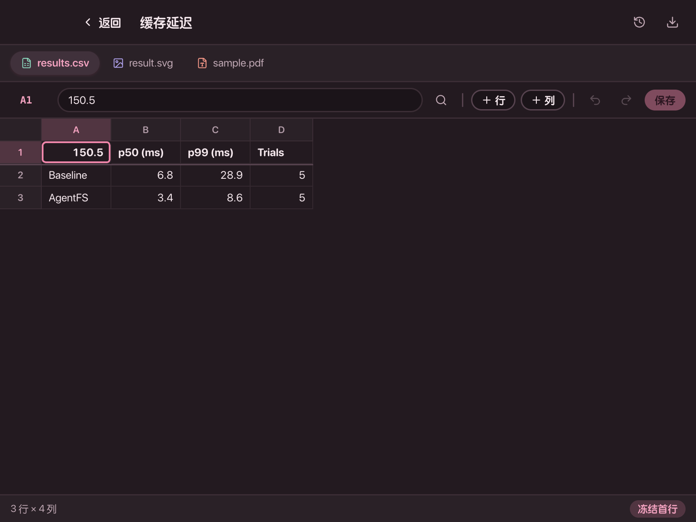

<div align="center">


# LabCanvas

**本地优先、Agent 原生的科研实验资料画布与版本化工作台**

将实验数据表、图表、PDF、日志与元数据收束进同一个本地资料库——空间画布与列表双视图自由组织，GUI 与 CLI/AI Agent 共享同一份 SQLite 与内容寻址存储。

[简体中文](README.md) · [English](README.en.md)

[](https://nodejs.org/)
[](https://www.electronjs.org/)
[](https://react.dev/)
[](https://www.sqlite.org/)
[](#设计原则与架构)

<br />

<picture>
  <source media="(prefers-color-scheme: dark)" srcset="docs/preview-canvas-dark.png" />
  <source media="(prefers-color-scheme: light)" srcset="docs/preview-canvas-light.png" />
  
</picture>

</div>

---

## 为什么选择 LabCanvas

科研与工程实验的产出天然分散：服务器拉回的 CSV/XLSX、脚本生成的 SVG/PNG/PDF、终端运行日志、实验参数与临时笔记。传统文件夹树只能表达单一归属，复制多份又会让数据与图表失步；而云端笔记工具既难以离线处理大体积原始文件，也缺乏面向自动化脚本与 AI Agent 的幂等写入接口。

LabCanvas 为这一工作流提供了一套完整且克制的本地基础设施：

- **条目即结果单元**：一张结果表和由它生成的若干图表可以组成同一条目，并排预览、共享实验日期、自定义属性与备注，也可随时合并或拆分。
- **引用式多维分类**：同一条目可同时归入 `实验日期/2026-11-10`、`模块测试/缓存`、`实验目的/Baseline` 等任意分类树，不复制原始文件；删除分类或移除引用绝不丢失底层数据。
- **双视图与独立布局**：在无界空间画布中拖拽排布卡片、添加便签与分组框，或一键切回支持自定义属性列与排序的列表视图；每个分类各自持久化画布坐标与视口缩放。
- **图表来源追踪与版本历史**：内置表格、文本、图片与 PDF 查看器；修改表格或文本自动创建新版本并支持一键回滚，当源数据表更新时自动标记关联图表已过期。
- **Agent 原生 CLI 与实时同步**：通过命令行或 JSON 清单完成批量预检（`--dry-run`）、幂等更新（`-k/--key`）与全文检索；CLI 写入本地资料库后，打开的桌面窗口自动实时刷新。
- **100% 本地与离线**：原生 `node:sqlite` + SHA-256 内容寻址对象库，服务仅绑定 `127.0.0.1` 回环地址，无账号、无遥测、无云端锁定，支持单命令热备份与一致性校验。

---

## 界面一览

<table>
  <tr>
    <td width="50%">
      
      <p align="center"><sub><b>空间画布（浅色模式）</b> — 真实内容缩略图、并排多文件预览与独立视图布局</sub></p>
    </td>
    <td width="50%">
      
      <p align="center"><sub><b>自适应紧凑布局（深色模式）</b> — 自动跟随系统浅/深外观，适配小屏与分屏工作流</sub></p>
    </td>
  </tr>
  <tr>
    <td colspan="2">
      
      <p align="center"><sub><b>内置数据查看与编辑</b> — 支持 CSV / TSV / XLSX 多工作表编辑、公式栏、冻结首行、TSV 粘贴与版本对比</sub></p>
    </td>
  </tr>
</table>

---

## 核心特性

| 模块 | 能力说明 |
| :--- | :--- |
| **空间画布与标注** | 无界平移缩放、卡片自由拖拽与调宽、自动整齐排布、Shift 框选多选、撤销/重做、画布便签与分组框；每个分类独立保存坐标与视口状态 |
| **列表与结构化筛选** | 列表视图支持按实验日期、文件数、大小、修改时间及任意自定义属性列（如 `lr`、`model`、`seed`）排序与显示控制，支持全局文件类型筛选 |
| **全文检索（FTS5）** | 基于 SQLite FTS5，跨标题、备注、实验属性、分类名称、文件名以及 CSV/文本文件内容进行实时检索，并返回上下文片段 |
| **内置查看器与并排对比** | 支持表格（CSV/TSV/XLSX）、图片（PNG/JPG/WebP/GIF/SVG/AVIF/TIFF）、PDF（基于 pdf.js）与 25+ 种文本/代码格式；支持两份文件或同一文件的不同版本**并排对比**（同步滚动 / 联动缩放 / 差异高亮） |
| **表格编辑与大表分页** | 内置虚拟滚动电子表格：公式栏编辑、多工作表切换、增删行列、TSV 批量粘贴、冻结表头；超过 20,000 行的超大工作表自动切换分页浏览 |
| **内容寻址与版本控制** | 文件按 SHA-256 去重存入不可变对象库；每次保存表格/文本或使用相同 `--key` 更新同名文件都会生成递增版本，随时查阅与恢复历史版本 |
| **来源过期提醒** | 条目内唯一表格会自动与同条目图片/PDF 建立来源关联（也可手动指定）；当源表格产生新版本时，界面与详情面板明确提示对应图表需重新生成 |
| **安全删除与打包导出** | 支持软删除回收站（保留原有分类引用与画布位置）、一键恢复、引用计数垃圾回收、条目 ZIP 打包导出以及带 SQLite 快照的资料库热备份 |

---

## 快速开始

### 环境要求

- **Node.js** `>= 22.13.0`（使用内置 `node:sqlite`，推荐使用 Node.js 24 LTS）
- **操作系统**：macOS（完整支持桌面打包与 `.command` 启动器）；浏览器模式与 CLI 支持 macOS / Linux / Windows

### 从源码安装与运行

```bash
# 1. 克隆仓库并安装依赖
git clone https://github.com/Livia-Tassel/LabCanvas.git
cd LabCanvas
npm ci

# 2. 构建前端与 PDF 渲染资源
npm run build

# 3. 启动 Electron 桌面应用
npm run desktop
```

其他常用启动方式：

| 方式 | 命令 | 说明 |
| :--- | :--- | :--- |
| **macOS 快捷启动** | 双击 `launch-labcanvas.command` | 自动检查环境并拉起桌面应用 |
| **本地 Web 模式** | `npm start` | 启动本地服务并访问 `http://127.0.0.1:4317` |
| **开发模式（热重载）** | `npm run dev` | 同时启动 Vite 开发服务器与本地 API 服务 |
| **导入演示项目** | `npm run demo` | 在当前资料库中生成模拟的 AgentFS 实验数据 |
| **打包 macOS 应用** | `npm run package:mac` | 生成 Apple Silicon 安装镜像 `release/LabCanvas-1.0.0-arm64.dmg` |

> [!NOTE]
> 默认资料库位于 `~/.labcanvas`。设置环境变量 `LABCANVAS_HOME=/path/to/dir` 可在桌面端、Web 端与 CLI 间切换至任意独立资料库目录。

---

## CLI 与 AI Agent 工作流

LabCanvas 为实验脚本和 AI Agent（如 Claude Code、Codex、Gemini CLI 等）提供一等公民命令行接口。CLI 直接操作本机 SQLite 与对象库，**在桌面窗口关闭时亦可独立运行**；当桌面窗口处于打开状态时，界面会通过本地事件流自动同步 CLI 的每一次写入。

可在项目根目录执行 `./labcanvas`，或执行一次 `npm link` 注册全局 `labcanvas` 命令：

```bash
# 创建项目并获取 JSON 输出（非 TTY 管道下自动启用 JSON 模式）
labcanvas project create AgentFS --slug agentfs --json

# 导入一次实验的表格与关联图表，写入属性并绑定稳定 key（支持幂等重跑）
labcanvas add results.csv plot.svg -p agentfs \
  -c "实验目的/Baseline" \
  -c "模块测试/缓存" \
  -d 2026-11-20 \
  -t "缓存延迟消融" \
  -f lr=3e-4 -f batch=64 \
  -k cache-ablation-001 --json

# 使用声明式清单进行预检与原子批量导入（任一校验失败整体回滚）
labcanvas import ./examples/manifest.json -p agentfs --dry-run --json
labcanvas import ./examples/manifest.json -p agentfs --json

# 跨文件与内容全文搜索
labcanvas search "Baseline" -p agentfs --json

# 热备份与资料库完整性体检
labcanvas backup ~/labcanvas-backup --json
labcanvas doctor --json
```

<details>
<summary><b>查看声明式批量导入清单示例（<code>examples/manifest.json</code>）</b></summary>

```json
{
  "$schema": "../docs/import.schema.json",
  "entries": [
    {
      "key": "example-cache-001",
      "title": "缓存延迟对比 · 模拟数据",
      "date": "2026-11-10",
      "note": "实验命令：python benchmark.py --config config.json",
      "collections": ["模块测试/缓存", "实验日期/2026-11-10", "实验目的/Baseline"],
      "files": [
        "results.csv",
        { "path": "result.svg", "source": "results.csv" }
      ]
    }
  ]
}
```

</details>

完整的 CLI 参数、错误码约定、JSON Schema 与本地 HTTP API 文档请参阅 **[Agent 接口文档](docs/AGENT_API.md)** 与 **[清单 Schema](docs/import.schema.json)**。

---

## 设计原则与架构

```text
┌───────────────────────────┐      ┌──────────────────────────────┐
│   Electron Desktop / Web  │      │     CLI / Scripts / Agents   │
│  React 19 + TS + Canvas   │      │    labcanvas add / import    │
└─────────────┬─────────────┘      └──────────────┬───────────────┘
              │ HTTP + SSE (127.0.0.1 only)       │ Direct SQLite Access
              ▼                                   ▼
┌─────────────────────────────────────────────────────────────────┐
│                    Local Store Engine (Node.js)                 │
│   Express 5 API  ·  ExcelJS / csv-parse  ·  Sharp  ·  ZIP       │
└─────────────┬───────────────────────────────────┬───────────────┘
              ▼                                   ▼
┌───────────────────────────┐      ┌──────────────────────────────┐
│      SQLite + FTS5        │      │   Content-Addressed Store    │
│  ~/.labcanvas/lab.sqlite  │      │  ~/.labcanvas/objects/<sha>  │
│  元数据·分类·布局·版本·索引  │      │     不可变原始文件与缩略图      │
└───────────────────────────┘      └──────────────────────────────┘
```

### 核心数据不变量

1. **导入即托管**：文件导入时复制到内容寻址对象库，不依赖原始磁盘路径继续存在，移动或清理临时实验目录不会破坏资料库。
2. **分类是纯引用**：同一条目出现在多个分类中仅增加一条关系记录，不复制文件，也不丢失彼此独立的画布排布。
3. **修改即版本**：表格与文本保存、或相同 `--key` 覆盖同名文件时，旧版本字节永久保留直至用户主动永久删除，彻底避免误覆盖实验原始数据。
4. **安全边界清晰**：本地 HTTP 服务强制校验回环 `Host` 与同源 `Origin`，配置严格 CSP；单文件上限 200 MB，内置文本编辑上限 2 MB，ZIP 导出上限 3.9 GB。

---

## 项目结构

```text
LabCanvas/
├── src/                  # React 19 + TypeScript 前端界面
│   ├── components/       # 画布、列表、侧边栏、详情面板、弹窗与视觉元素
│   └── viewer/           # 内置表格、图片、PDF、文本查看器与并排对比引擎
├── server/               # 本地服务与存储引擎（SQLite、CAS 对象库、文件解析、ZIP 导出）
├── cli/                  # Agent 友好的 CLI 入口（labcanvas）
├── desktop/              # Electron 桌面主进程、预加载脚本与应用图标
├── docs/                 # Agent API 文档、JSON Schema、产品规格与验收记录
├── examples/             # 可直接导入的示例数据与 manifest.json
├── scripts/              # 开发启动、资源构建、macOS 打包与桌面验收脚本
└── tests/                # 单元测试与 Playwright 端到端工作流测试
```

---

## 质量保障与测试

项目覆盖数据层/HTTP/CLI 单元测试、Chromium 端到端工作流测试以及 Electron 桌面实机验收：

```bash
npm run check                        # TypeScript 类型检查 + 生产构建 + 核心单元测试
npm run test:e2e                     # Playwright 端到端全流程测试（首次需 npx playwright install chromium）
npm run test:desktop -- --source     # Electron 桌面端窗口、深浅主题与服务复用验收
```

详细测试矩阵与历史验收记录见 [验收记录](docs/VALIDATION.md)。

---

## 延伸文档

- [Agent CLI 与本地 HTTP API 手册](docs/AGENT_API.md)
- [导入清单 JSON Schema](docs/import.schema.json)
- [产品范围与数据规则](docs/PRODUCT.md)
- [验收与测试记录](docs/VALIDATION.md)
